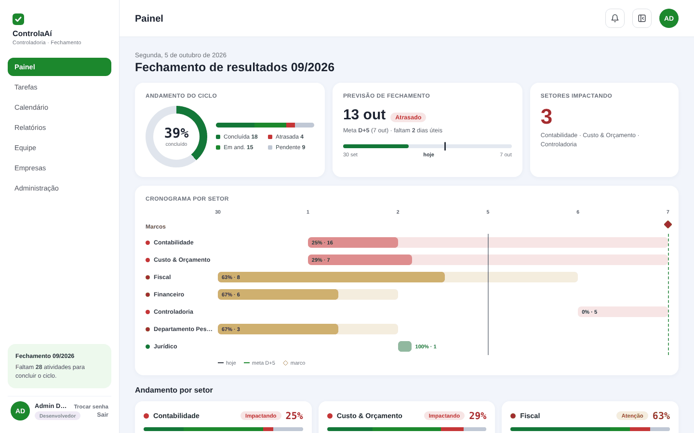
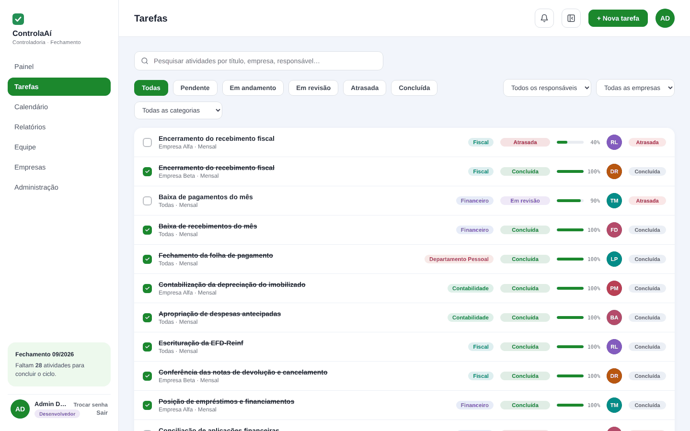
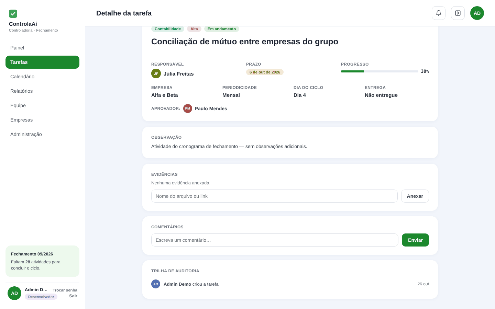
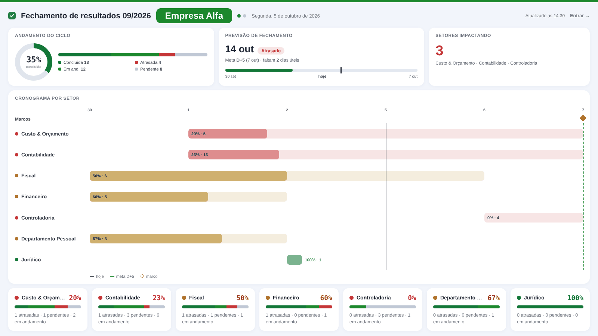

# ControlaAí: gestão do fechamento contábil

Aplicação web que a Controladoria usa para conduzir o fechamento contábil mensal: cronograma por dia útil (D-1 a D+5), responsáveis por tarefa, aprovação com segregação de funções, dependências entre tarefas, trilha de auditoria e um painel que mostra, em tempo real, se o fechamento vai cumprir a meta.

> Este repositório roda com **dados fictícios**: empresas, pessoas e tarefas foram inventadas. O código é o mesmo da aplicação em uso.



## O problema

O fechamento era controlado por planilha. Ninguém sabia, no meio do ciclo, quais setores estavam atrasando o resultado, nem se a meta de D+5 ia ser cumprida. A cobrança acontecia por mensagem, e o histórico de quem fez o quê se perdia a cada mês.

## O que a aplicação faz

- **Cronograma em dias úteis.** Cada tarefa tem um "Dia N" do ciclo, e o prazo é recalculado a cada competência com o calendário de feriados.
- **Previsão de fechamento.** O painel projeta a data de término pelo ritmo do ciclo e marca os setores que estão impactando a meta.
- **Segregação de funções.** Quem executa não aprova. A regra é aplicada no servidor, não só escondida na tela.
- **Dependências.** Uma tarefa bloqueada só começa quando a anterior é concluída (por exemplo, o encerramento do período depois do balancete).
- **Trilha de auditoria append-only.** Toda mudança de status, comentário e evidência fica registrada.
- **Encerramento de ciclo com snapshot.** O ciclo fechado vira histórico para comparar meses, e o próximo ciclo nasce com os prazos recalculados.
- **Modo TV.** Um painel em tela cheia, sem login, que alterna entre as empresas do grupo para ficar na parede da área.

| Tarefas | Detalhe com aprovação e auditoria |
|---|---|
|  |  |



## Stack

| Camada | Tecnologia |
|---|---|
| Frontend | React 18 + Vite |
| Backend | Node.js + Express, API REST |
| Banco | SQLite (better-sqlite3), com migração direta para Postgres |
| Autenticação | bcrypt + JWT localmente, ou Microsoft Entra ID no Azure App Service |
| Deploy | Azure App Service: o Express serve a API e o frontend compilado ([guia](AZURE-DEPLOY.md)) |

## Onde fica cada regra

- **Servidor** (`server/src/rules.js`, `service.js`, `authz.js`): dias úteis, status efetivo, aprovação e segregação de funções, dependências, reabertura, trilha de auditoria e encerramento de ciclo.
- **Cliente** (`web/src/lib/model.js`): previsão de fechamento, cronograma por setor, notificações e comparativo entre ciclos.

## Rodando

Precisa de Node.js 20.

```bash
# backend
cd server
npm install
npm run seed      # cria o banco com dados fictícios
npm start         # API em http://localhost:4000

# frontend (outro terminal)
cd web
npm install
npm run dev       # app em http://localhost:5173
```

O seed monta o ciclo do mês anterior à data de hoje e simula o andamento das tarefas em relação a hoje (concluídas, em revisão, atrasadas e pendentes).

### Perfis de teste

Senha de todos os usuários semeados: `ControlaAi@2026` (configurável em `server/.env`).

| Papel | E-mail | O que pode |
|---|---|---|
| Desenvolvedor | `admin@exemplo.com.br` | tudo, inclusive papéis, setores e encerramento de ciclo |
| Gestor | `marina.castro@exemplo.com.br` | o escopo dos seus setores: cria, edita e aprova tarefas |
| Usuário | `bruno.alves@exemplo.com.br` | só as próprias tarefas: status, evidência e comentários |

O frontend esconde o que o papel não permite, e o backend nega.

## Estrutura

```
server/src/
  index.js       rotas HTTP
  db.js          esquema do banco
  rules.js       dias úteis, feriados, status efetivo
  service.js     operações de tarefa e encerramento de ciclo
  authz.js       regras de papel
  auth.js        bcrypt, JWT e Entra ID
  admin.js       usuários, governança e empresas
  seed.js        carga inicial a partir de dados.seed.js (fictício)
web/src/
  screens/       Login, Painel, Tarefas, Calendário, Detalhe, Relatórios, Equipe, Empresas, Administração, Modo TV
  lib/           api.js, model.js (previsão e cronograma), theme.js
docs/telas/      capturas de tela com os dados fictícios
```

---

Rafael Gomes · [LinkedIn](https://www.linkedin.com/in/rafael-gomes-analista-de-dados) · [Portfólio](https://app.xperiun.com/in/rafagomes)
